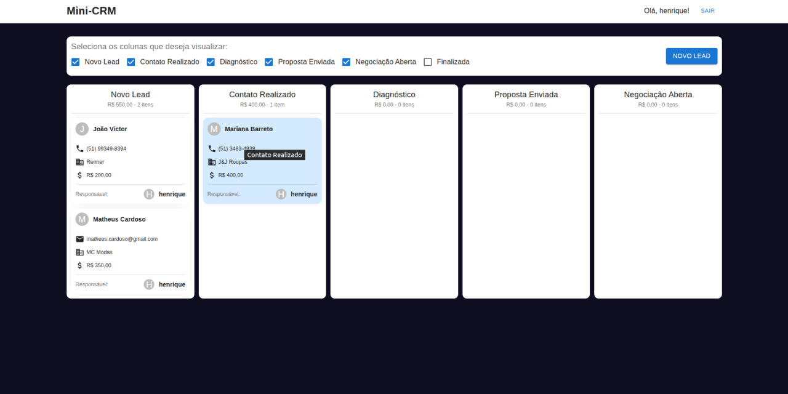

# Mini-CRM



Development of a Mini-CRM as a practical challenge. The Mini-CRM must support creating, editing, removing, and tracking Leads. It also must allow the creation, editing, removal, and tracking of interactions with leads.

## Production

This project was previously published on Railway and was available at the following URL: [https://mini-crm-altervision.up.railway.app/](https://mini-crm-altervision.up.railway.app/)

That environment no longer exists and is no longer active, so the app is not currently running there. To run the project locally, follow the steps in the Development section below.

## Development

To run the application locally, clone the project and rename the .env-example file to .env.

Then run the following command:

```
docker compose up --build
```

A local development environment will be started, with the backend available on port 3001 and the frontend on port 3000.
